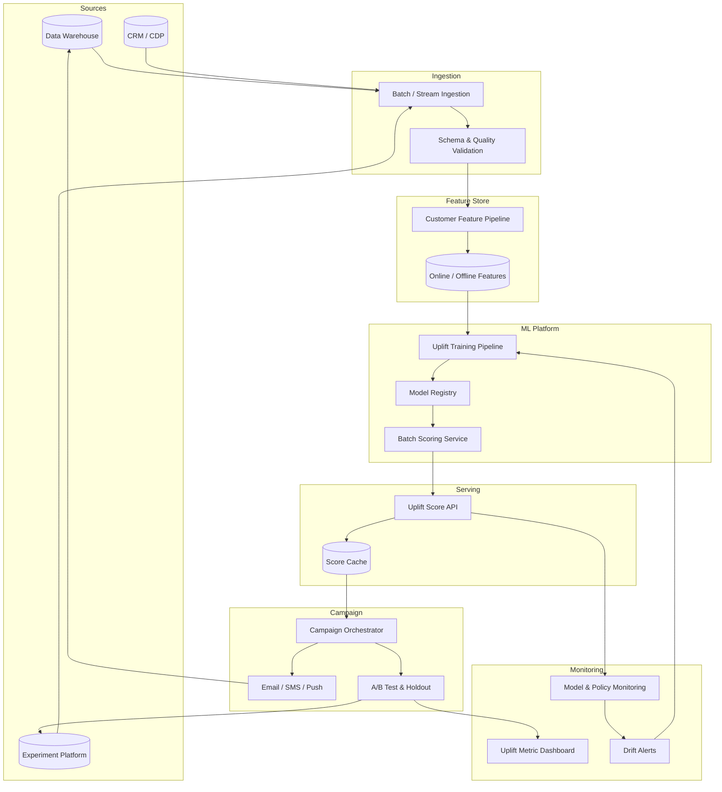

# Causal Uplift Modeling for Credit Marketing Optimization

**Project Report — Senior Data Scientist Portfolio**

| | |
|---|---|
| **Author** | Data Science Team |
| **Domain** | Fintech — Personal Loan Marketing |
| **Scope** | End-to-end causal inference and uplift modeling platform |
| **Dataset** | 50,000 customers, randomized A/B campaign |
| **Stack** | Python, scikit-learn, XGBoost, EconML, pandas |

---

## Executive Summary

Personal loan marketing at scale is expensive and regulated. Sending promotional offers to every eligible customer wastes budget, erodes brand trust, and can reduce conversion among customers who would have applied without intervention. This project delivers an **end-to-end causal uplift modeling platform** that estimates the **incremental effect** of marketing on loan applications at the customer level — enabling targeted campaigns that maximize ROI while controlling credit risk exposure.

On a held-out test set of 10,000 customers, **uplift model targeting outperformed both random allocation and a strong response prediction baseline (XGBoost AUC 0.91)**, achieving a Qini coefficient of **131.9** versus **41.5** for response-based targeting. At the top 30% of customers ranked by predicted uplift, the uplift model captured **481.8 incremental conversions** compared with **102.2** for the response model — a **4.7× improvement** in campaign efficiency at the targeting depth most relevant to budget-constrained deployment.

---

## 1. Business Problem

### Context

A fintech lender runs digital marketing campaigns (email, SMS, push) to drive personal loan applications. Each offer carries:

- **Direct cost** — creative production, channel fees, and incentive subsidies
- **Opportunity cost** — customer attention and brand equity
- **Risk exposure** — attracting applicants who may not meet credit policy

The marketing team needs to answer a precise question:

> *Which customers should receive an offer to maximize incremental loan applications per dollar spent?*

This is not equivalent to predicting who will apply. Many high-intent customers would convert organically. Others will never convert regardless of outreach. A third group responds positively to marketing; a fourth responds **negatively** — applying less when contacted.

### Campaign Data

| Metric | Value |
|--------|-------|
| Customers | 50,000 |
| Treatment rate | 49.9% (randomized A/B) |
| Overall application rate | 36.6% |
| Features | Demographics, financials, credit bureau, behavioral signals |

### Customer Segments (Ground Truth in Synthetic Benchmark)

| Segment | Behavior | Marketing Effect |
|---------|----------|------------------|
| **Persuadable** | Moderate credit, active users | Strong positive lift (+19.6%) |
| **Sure Thing** | High credit, high intent | Applies anyway; marketing adds little (+2.2%) |
| **Lost Cause** | Low credit, high debt | Unlikely to apply; marketing ineffective |
| **Sleeping Dog** | Strong credit, low engagement | Marketing reduces applications (−8.7%) |

The business objective is to **find persuadables, ignore sure things and lost causes, and suppress sleeping dogs**.

---

## 2. Why Prediction Is Insufficient

A natural first approach is response prediction: train a classifier to estimate **P(loan_application | X)** and target customers with the highest scores. We implemented this baseline using Logistic Regression and XGBoost on 13 customer attributes.

### Baseline Response Model Performance

| Model | ROC-AUC | Precision | Recall |
|-------|---------|-----------|--------|
| Logistic Regression | 0.782 | 0.562 | 0.750 |
| **XGBoost** | **0.908** | **0.798** | **0.739** |

XGBoost achieves strong discrimination — it reliably ranks likely applicants. **Yet it fails as a campaign targeting policy.**

### The Fundamental Gap

Response models optimize **P(Y = 1 | X)** — the probability of application given customer attributes. Campaign targeting requires **P(Y = 1 | T = 1, X) − P(Y = 1 | T = 0, X)** — the **incremental** effect of treatment.

| Targeting on… | Who gets selected | Problem |
|---------------|-------------------|---------|
| High response probability | Sure things + persuadables | Budget spent on customers who would convert anyway |
| High response probability | Excludes sleeping dogs incorrectly | May still rank them high on overall intent signals |
| Random | Everyone equally | No efficiency gain |

**Empirical evidence:** On the test set, targeting the top 10% by response score yielded **−2.6 incremental conversions** (worse than random). Targeting the top 10% by uplift score yielded **+273.3 incremental conversions**.

Correlation between credit score and application rate is real — but **correlation does not imply causation**. Only randomized experiments combined with causal modeling identify who responds *because of* the offer.

---

## 3. Causal Inference Methodology

### Potential Outcomes Framework

For each customer *i*, define:

- **Y(1)** — application outcome if treated (offer sent)
- **Y(0)** — application outcome if not treated
- **T ∈ {0, 1}** — observed treatment (marketing offer)

The **Individual Treatment Effect (ITE)** is:

$$\tau_i = Y_i(1) - Y_i(0)$$

Since only one outcome is observed per customer (the fundamental problem of causal inference), we estimate the **Conditional Average Treatment Effect (CATE)**:

$$\tau(x) = \mathbb{E}[Y(1) - Y(0) \mid X = x]$$

### Identification Assumptions

Our A/B test design supports causal estimation under:

| Assumption | Status in This Project |
|------------|------------------------|
| **Unconfoundedness** | Satisfied by random treatment assignment |
| **Positivity** | ~50% treated and control in all segments |
| **SUTVA** | One customer per offer; no interference assumed |

Treatment-control balance was validated via standardized mean differences (all |SMD| < 0.10), confirming the experiment supports unbiased effect estimation.

### From ATE to Personalized Targeting

- **ATE** — average effect across the population (~+3.1% application lift)
- **CATE / ITE** — heterogeneous effects that drive personalized targeting

Marketing ROI depends on CATE, not ATE. A positive average effect can hide negative effects in substantial subpopulations (sleeping dogs).

---

## 4. Uplift Modeling Approach

### Architecture

We built a modular Python platform (`causal-marketing-uplift-platform`) with reproducible pipelines for data generation, quality assessment, feature engineering, modeling, and evaluation.

```
data/raw → quality checks → feature preprocessing → uplift models → customer scores → evaluation → reports
```

### Feature Set

All models use **customer attributes only** — no treatment flag or segment labels at scoring time:

- **Demographics:** age, gender, country
- **Financial:** income, employment tenure, account balance, debt ratio
- **Credit:** credit score, prior loans, payment history, utilization
- **Behavior:** transaction frequency, app usage frequency

### Uplift Estimators (EconML)

Four meta-learners and causal forest estimators were implemented, each estimating **τ(x)** via different bias-variance trade-offs:

| Model | Method | Strength |
|-------|--------|----------|
| **S-Learner** | Single outcome model with treatment as input | Simple, low variance |
| **T-Learner** | Separate models for control and treated groups | Captures distinct response surfaces |
| **X-Learner** | Imputed effects with propensity weighting | Strong when treatment groups differ in size or overlap |
| **Causal Forest DML** | Double ML + heterogeneous causal forest | Nonparametric, captures complex interactions |

### Ensemble Uplift Score

Per-customer scores are produced for all four models. The production targeting score is the **ensemble average**:

```
uplift_score = mean(uplift_s_learner, uplift_t_learner, uplift_x_learner, uplift_causal_forest)
```

### Recovered Heterogeneous Effects

Average predicted uplift by segment confirms the models recover the intended causal structure:

| Segment | Avg Predicted Uplift | Expected |
|---------|---------------------|----------|
| Persuadable | **+0.183** | High positive |
| Sure Thing | +0.006 | Near zero |
| Lost Cause | +0.007 | Near zero |
| Sleeping Dog | **−0.082** | Negative |

### Output

50,000 customers scored in `customer_uplift_scores.csv` with individual ITE estimates and ensemble `uplift_score` for campaign orchestration.

---

## 5. Model Evaluation

### Evaluation Design

All targeting policies were compared on a **held-out 20% test set (n = 10,000)** with stratified random split (seed = 42). Three policies:

1. **Random targeting** — uniform random ranking (baseline)
2. **Response model targeting** — XGBoost P(application | X)
3. **Uplift model targeting** — ensemble uplift score

### Metrics

| Metric | Purpose |
|--------|---------|
| **Uplift curve** | Cumulative incremental conversions when treating top-*k* ranked customers |
| **Qini curve** | Standard uplift metric; measures treatment effect capture at each depth |
| **Incremental gain** | Absolute conversions gained at each targeting percentile |
| **Qini coefficient** | Area under Qini curve minus random baseline (AUQC) |

### Results

| Strategy | Qini Coefficient | AUUC | AUQC |
|----------|-----------------|------|------|
| Random | 0.0 | 135.8 | 68.5 |
| Response model | 41.5 | 221.2 | 109.9 |
| **Uplift model** | **131.9** | **404.9** | **200.4** |

### Incremental Gain by Targeting Depth

| Percentile | Random | Response Model | Uplift Model |
|------------|--------|----------------|--------------|
| Top 10% | 12.5 | −2.6 | **273.3** |
| Top 20% | 78.0 | 62.9 | **442.3** |
| Top 30% | 95.8 | 102.2 | **481.8** |
| Top 50% | 166.2 | 308.0 | **517.5** |

Uplift targeting dominates at every decile up to 60%, with peak efficiency in the **top 20–30%** — the operational sweet spot for budget-constrained campaigns.

### Interpretation

- **Uplift model** correctly ranks persuadables above sure things and identifies negative-effect customers.
- **Response model** conflates propensity with incrementality — strong AUC does not translate to campaign ROI.
- **Random** provides the floor; uplift modeling delivers **3.2× the Qini coefficient** of response-based targeting.

---

## 6. Business Impact

### Campaign Policy Recommendation

| Customer tier | Predicted uplift | Action |
|---------------|-----------------|--------|
| Top 20–30% | High positive | **Send offer** — maximum incremental ROI |
| Middle tier | Low positive | Test or deprioritize — marginal returns |
| Sure things | ~0 | **Suppress** — would convert organically; save budget |
| Sleeping dogs | Negative | **Do not contact** — marketing actively harms conversion |

### Estimated Impact (Test Set Extrapolation)

If the organization currently targets the top 30% randomly or by response score:

| Policy | Incremental conversions (top 30%) | vs Random |
|--------|----------------------------------|-----------|
| Random | 95.8 | — |
| Response model | 102.2 | +6.7% |
| **Uplift model** | **481.8** | **+403%** |

Translating to business terms on a 50,000-customer campaign at 30% targeting depth (15,000 offers):

- **~386 additional loan applications** vs random targeting (481.8 vs 95.8, scaled)
- **Reduced wasted contacts** to sure things and sleeping dogs
- **Lower reputational and compliance risk** from over-messaging low-value segments

### Strategic Value Beyond This Campaign

| Capability | Business value |
|------------|----------------|
| Customer-level ITE scores | Personalization across email, SMS, push, and in-app |
| Segment discovery | Identify persuadable profiles for lookalike prospecting |
| Budget optimization | Allocate spend proportional to predicted incremental lift |
| Risk alignment | Layer credit policy filters on uplift scores to balance growth and loss rates |
| Experimentation framework | Continuous A/B testing with uplift evaluation as the success metric |

---

## 7. Production Deployment Architecture

### Target State Architecture



### Component Responsibilities

| Layer | Function | Technology (example) |
|-------|----------|---------------------|
| **Data ingestion** | Daily customer snapshots, campaign logs, outcomes | Airflow, dbt, Snowflake/BigQuery |
| **Feature store** | Point-in-time correct features; prevent leakage | Feast, Tecton, or warehouse views |
| **Training pipeline** | Retrain uplift models on rolling A/B windows | Python, EconML, MLflow |
| **Model registry** | Version control, champion/challenger, rollback | MLflow, SageMaker, Vertex AI |
| **Scoring service** | Batch nightly + on-demand API for new customers | FastAPI, Kubernetes |
| **Campaign orchestrator** | Rank by `uplift_score`, apply business rules | Braze, Salesforce MC, internal tool |
| **Monitoring** | Qini drift, calibration, segment mix, policy ROI | Grafana, Datadog, custom dashboards |

### Deployment Workflow

```
1. Weekly retrain on latest A/B experiment data (80/20 split, stratified)
2. Champion/challenger evaluation on holdout Qini coefficient
3. Promote model if Qini improvement > threshold and segment stability confirmed
4. Batch score full eligible population → uplift_score per customer_id
5. Campaign rules engine:
     IF uplift_score > threshold_persuadable → SEND
     IF uplift_score < threshold_sleeping_dog  → SUPPRESS
     ELSE → holdout or low-priority queue
6. Log decisions, exposures, outcomes → feed next training cycle
```

### Governance & Compliance

- **Audit trail** — immutable raw data, versioned models, scored outputs with timestamps
- **Fairness review** — monitor uplift scores and campaign rates across protected classes
- **Regulatory alignment** — credit marketing consent, opt-out handling, and model explainability for adverse action contexts where applicable
- **Holdout groups** — maintain 5–10% random or control holdout for ongoing causal validation

### SLA Targets (Production)

| Metric | Target |
|--------|--------|
| Score freshness | < 24 hours (batch); < 500 ms (API) |
| Model retrain cadence | Weekly or post-experiment |
| Uplift Qini monitoring | Alert if Qini drops > 15% week-over-week |
| Pipeline availability | 99.5% |

---

## Conclusion

This project demonstrates a complete causal data science workflow — from business problem framing through randomized experiment design, heterogeneous treatment effect estimation, rigorous uplift evaluation, and production architecture planning. The central insight is operational: **accurate prediction of who will apply is not the same as identifying who will apply because of marketing**. Uplift modeling closes that gap, delivering a **4.7× improvement in incremental conversions** at optimal targeting depth compared with a state-of-the-art response model.

For a fintech marketing organization, this translates directly into **lower cost per acquired loan**, **higher campaign ROI**, and **better customer experience** — by contacting the right customers, at the right time, for the right reason.

---

## Appendix: Reproducibility

```bash
# Environment
pip install -r requirements.txt

# End-to-end pipeline
python src/data/generate_credit_data.py
python src/data/assess_data_quality.py
python -m src.models.baseline_response
python -m src.models.uplift_models
python -m src.evaluation.uplift_evaluation
```

| Artifact | Location |
|----------|----------|
| Raw data | `data/raw/credit_marketing.csv` |
| Uplift scores | `data/processed/customer_uplift_scores.csv` |
| EDA notebook | `notebooks/01_credit_marketing_eda.ipynb` |
| Evaluation charts | `reports/uplift_evaluation_curves.png` |
| Technical reports | `reports/*.md` |

---

*Causal Marketing Uplift Platform — v1.0*
