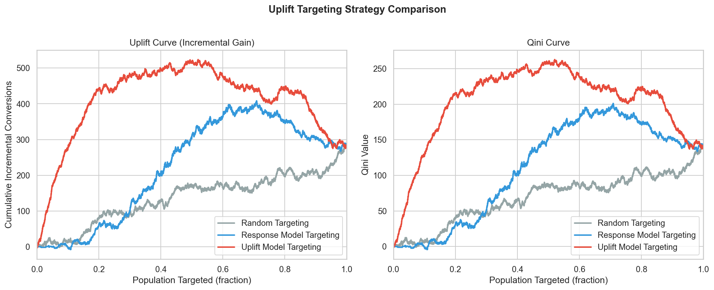
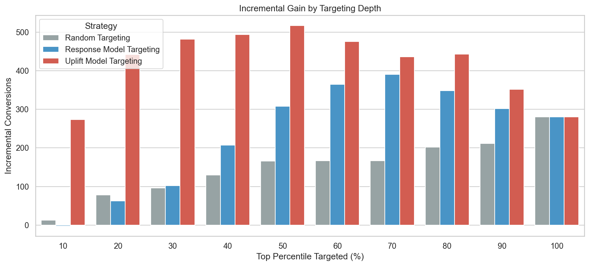

# Uplift Model Evaluation Report

- **Evaluation set:** 10,000 customers (held-out test split, 20%)
- **Treatment rate:** 49.90%
- **Response rate:** 36.81%

## Objective

Compare three targeting policies for the credit marketing campaign:

| Strategy | Ranking criterion |
| --- | --- |
| Random targeting | Uniform random scores |
| Response model targeting | XGBoost P(loan_application \| X) |
| Uplift model targeting | Ensemble uplift score (EconML ITE) |

Customers are ranked by score (descending) and evaluated at increasing targeting depths.

## Metrics

### Uplift Curve
Cumulative incremental conversions when treating the top *k* ranked customers:

```
Uplift(k) = (response_rate_treated(k) - response_rate_control(k)) × k
```

### Qini Curve
Standard Qini formulation measuring cumulative treatment effect capture:

```
Qini(k) = conv_treated(k) - conv_control(k) × n_treated(k) / n_control(k)
```

### Incremental Gain
Absolute uplift curve value at each targeting percentile — extra conversions
vs treating nobody, under the experimental sample.

## Summary Metrics

| Strategy | Qini Coefficient | AUUC | AUQC |
| --- | --- | --- | --- |
| Random Targeting | 0.00 | 135.81 | 68.47 |
| Response Model Targeting | 41.46 | 221.19 | 109.93 |
| Uplift Model Targeting ← best | 131.91 | 404.86 ← best | 200.38 |

## Incremental Gain by Targeting Depth

| Percentile | Random | Response Model | Uplift Model |
| --- | --- | --- | --- |
| Top 10% | 12.5 | -2.6 | 273.3 |
| Top 20% | 78.0 | 62.9 | 442.3 |
| Top 30% | 95.8 | 102.2 | 481.8 |
| Top 40% | 129.8 | 207.0 | 493.7 |
| Top 50% | 166.2 | 308.0 | 517.5 |
| Top 60% | 166.8 | 364.9 | 475.9 |
| Top 70% | 166.4 | 391.0 | 436.6 |
| Top 80% | 201.7 | 348.8 | 443.1 |
| Top 90% | 211.9 | 302.3 | 352.0 |
| Top 100% | 280.7 | 280.7 | 280.7 |

## Charts





## Key Findings

- **Uplift model targeting** achieves the highest Qini coefficient (131.9), confirming it best ranks customers by incremental response.
- **Response model targeting** optimizes for likely converters, not incremental lift — it underperforms uplift at top deciles (e.g. top 30% gain: 102.2 vs 481.8).
- **Random targeting** baseline gain at top 30%: 95.8.
- For campaign ROI, prioritize customers with high predicted **uplift**, not high response probability.

## Recommendation

Deploy **uplift model targeting** for campaign allocation. Treat the top 20–30% by
`uplift_score` and suppress offers for customers with negative predicted uplift (sleeping dogs).